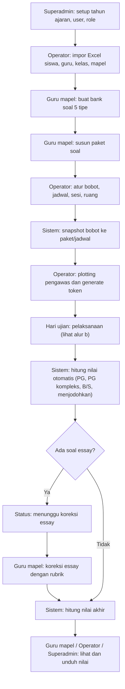
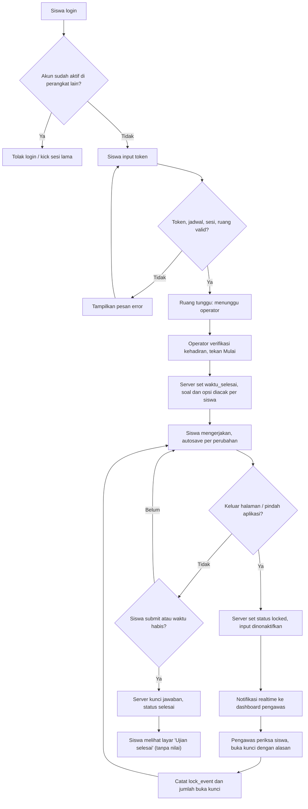
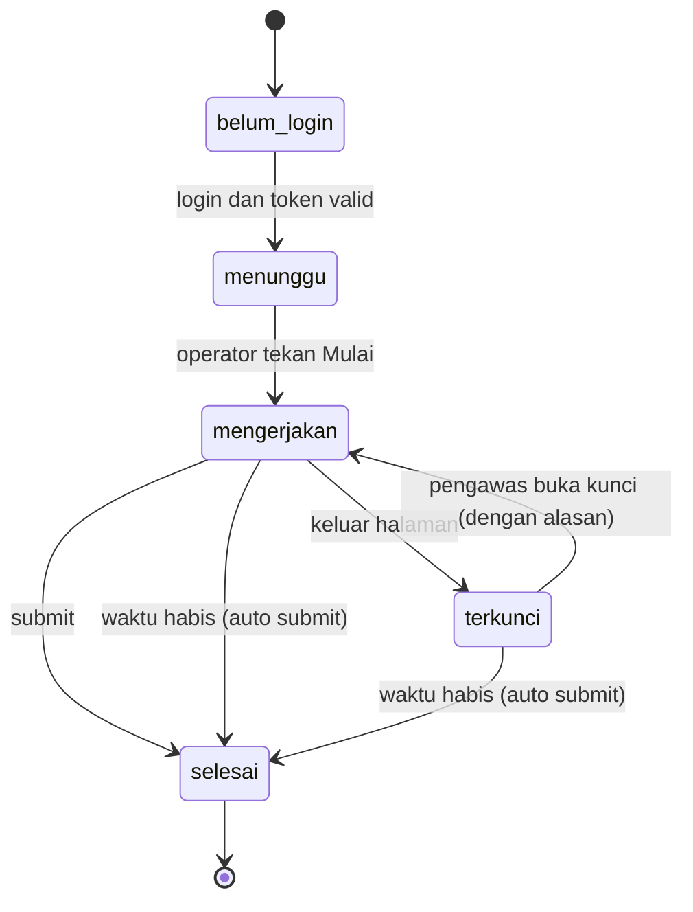
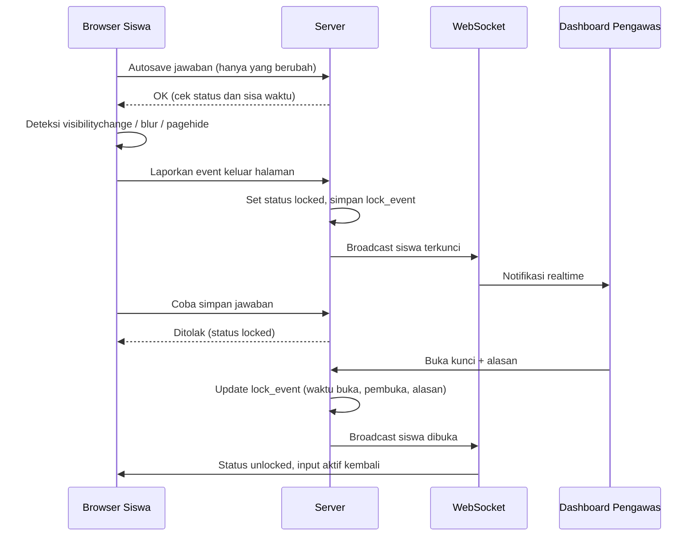

# Ide Website Ujian Sekolah (CBT)

> Dokumen hasil brainstorming sebagai acuan tahap berikutnya (analisis kebutuhan, desain database, UI/UX, dan pengembangan).
> Status: **Draft ide v2**. Pertanyaan terbuka sudah dijawab (lihat bagian 10), siap lanjut ke desain database.

---

## 1. Ringkasan Proyek

Website ujian sekolah berbasis komputer (Computer Based Test) dengan **4 role pengguna**. Sistem mendukung **5 jenis soal** dengan bobot berbeda, penguncian sesi ujian saat siswa keluar dari halaman, dan pengambilan nilai langsung oleh guru mapel terkait.

**Tujuan utama**
- Ujian berjalan tertib, aman, dan terpantau secara realtime.
- Admin (Operator) mudah mengatur seluruh keberlangsungan ujian.
- Guru mudah mengelola soal dan mengambil nilai tanpa rekap manual.
- Siswa mengerjakan ujian dengan antarmuka sederhana dan stabil.

---

## 2. Role Pengguna (4 Role)

| Role | Tanggung jawab |
|---|---|
| **Superadmin** | Kelola semua: user, role, tahun ajaran, pengaturan sistem, log aktivitas, backup |
| **Admin (Operator)** | Mapel, kelas/rombel, ruang dan sesi, jadwal ujian, token, bobot soal, plotting pengawas, verifikasi kehadiran dan tekan **Mulai** ujian, kartu peserta, reset login |
| **Guru** | **Peran 1 (guru mapel):** bank soal, paket soal, koreksi essay, lihat/unduh nilai mapelnya. **Peran 2 (pengawas):** monitoring ruang, buka kunci siswa, berita acara |
| **Siswa** | Login, input token, mengerjakan ujian (nilai **tidak** ditampilkan ke siswa) |

**Catatan hak akses guru**
- Sebagai guru mapel: akses soal dan nilai hanya untuk mapel dan kelas yang diampu.
- Sebagai pengawas: akses hanya untuk ruang/sesi yang ditugaskan operator. Guru boleh mengawas mapel lain tetapi **tidak boleh melihat soal atau nilai** mapel tersebut.

### Matriks Hak Akses

| Fitur | Superadmin | Operator | Guru | Siswa |
|---|:-:|:-:|:-:|:-:|
| Kelola user dan pengaturan sistem | ✅ | ❌ | ❌ | ❌ |
| Mapel, jadwal, sesi, token, bobot | ✅ | ✅ | ❌ | ❌ |
| Plotting pengawas | ✅ | ✅ | ❌ | ❌ |
| Verifikasi kehadiran dan tekan Mulai ujian | ✅ | ✅ | ❌ | ❌ |
| Bank soal dan paket soal | ✅ | ❌ | ✅ (mapelnya) | ❌ |
| Koreksi essay | ✅ | ❌ | ✅ (mapelnya) | ❌ |
| Lihat/unduh nilai | ✅ | ✅ | ✅ (mapelnya) | ❌ |
| Monitoring dan buka kunci | ✅ | ✅ | ✅ (ruang yang diawasi) | ❌ |
| Mengerjakan ujian | ❌ | ❌ | ❌ | ✅ |

---

## 3. Jenis Soal dan Penilaian

Lima tipe soal, bobot diatur oleh **operator**.

| Tipe | Cara penilaian |
|---|---|
| **Pilihan Ganda (PG)** | Satu jawaban benar, otomatis |
| **PG Kompleks** | Lebih dari satu jawaban benar. Aturan skor: **all-or-nothing** (semua pilihan harus tepat, jika tidak 0) |
| **Benar/Salah** | Satu pernyataan, atau tabel beberapa pernyataan yang masing-masing dinilai |
| **Memasangkan (Menjodohkan)** | Nilai per pasangan yang benar (partial) |
| **Essay** | Koreksi manual oleh guru, dengan rubrik dan kunci jawaban sebagai panduan |

**Rumus nilai**

```
Nilai akhir = (total skor diperoleh / total skor maksimal) x 100
```

**Catatan penting**
- Bobot per tipe soal di-*snapshot* saat paket/jadwal ujian dibuat, supaya perubahan bobot di kemudian hari tidak mengubah nilai ujian yang sudah berjalan.
- Nilai sementara ditandai "menunggu koreksi essay" sampai guru selesai mengoreksi.

---

## 4. Aturan Pelaksanaan Ujian

### 4.1 Alur Ujian

1. Operator membuat jadwal, sesi, ruang, dan token.
2. Operator melakukan plotting pengawas (guru) ke tiap sesi.
3. Siswa login, lalu memasukkan token. Sistem memvalidasi jadwal, sesi, dan ruang.
4. Operator memverifikasi kehadiran dan menekan **Mulai** (guru pengawas tidak memiliki akses ini).
5. Siswa mengerjakan, jawaban *autosave* setiap ada perubahan.
6. Jika siswa keluar halaman, **sesi langsung terkunci**.
7. Pengawas membuka kunci setelah memeriksa siswa.
8. Siswa submit, atau otomatis submit saat waktu habis.
9. Nilai otomatis dihitung, essay menunggu koreksi guru mapel.

### 4.2 Alur Sistem

#### a. Alur Umum (Persiapan sampai Nilai)



#### b. Alur Pelaksanaan Ujian (Siswa, Operator, dan Pengawas)



#### c. Status Peserta Ujian (`peserta_ujian.status`)



> Waktu tetap berjalan saat status `terkunci`. Jika waktu habis selama terkunci, server otomatis submit jawaban terakhir yang tersimpan.

#### d. Alur Kunci dan Buka Kunci (Teknis)



### 4.3 Aturan Kunci Sesi (tanpa toleransi)

- Pemicu kunci: pindah tab, minimize, buka aplikasi lain, keluar dari fullscreen.
- Begitu terpicu, sesi **langsung terkunci**, layar siswa menampilkan "Ujian terkunci, hubungi pengawas", dan semua input dinonaktifkan.
- Dashboard pengawas menerima notifikasi realtime.
- Hanya **guru pengawas** (atau operator/superadmin) yang bisa membuka kunci, dengan **mengisi alasan**.

**Poin teknis**
- Status `locked` **disimpan di server/database**. Server menolak simpan jawaban selama sesi terkunci. Penguncian hanya di browser tidak cukup karena bisa diakali.
- Jika koneksi putus saat siswa keluar halaman, begitu siswa kembali dan koneksi pulih, client langsung memeriksa status ke server dan mengunci sesi sendiri.
- **Timer saat terkunci** (pengaturan operator):
  - **Keputusan: waktu tetap berjalan** selama sesi terkunci. Tidak ada kompensasi waktu.
  - Karena ujian lewat HP (kunci mudah terpicu tak sengaja), sosialisasi ke siswa wajib, dan proses buka kunci harus secepat mungkin.
- Pemicu tak sengaja (notifikasi, telepon masuk, layar mati) tetap mengunci. Sosialisasikan ke siswa dan buat alur buka kunci cepat.
- Jumlah buka kunci per siswa dicatat. Jika berulang, pengawas mendapat peringatan dan dapat mencatatnya di berita acara.

### 4.4 Aturan Tambahan (disetujui)

- Satu akun hanya aktif di satu perangkat (login ganda ditolak atau sesi lama otomatis di-kick).
- Blokir klik kanan, copy, paste, dan print screen (sebatas kemampuan browser).
- Soal dan opsi jawaban diacak per siswa.
- Timer dihitung di **server**, bukan di browser.

### 4.5 Catatan Khusus Ujian di HP Siswa

- Di HP, notifikasi masuk, telepon, layar mati, dan gesture pindah aplikasi akan memicu kunci. Dengan timer tetap berjalan, siswa bisa kehilangan waktu. Mitigasi: instruksikan siswa mengaktifkan **mode jangan ganggu/pesawat + WiFi**, dan siapkan alur buka kunci cepat.
- **Fullscreen API tidak didukung di iPhone (Safari).** Pemicu kunci di HP bertumpu pada `visibilitychange`, `blur`/`pagehide`, bukan fullscreen.
- Opsi penguat: PWA, atau aplikasi wrapper Android (WebView) yang bisa memblokir screenshot (`FLAG_SECURE`) dan screen pinning. Untuk iOS pakai Guided Access (diaktifkan manual oleh siswa) atau Safe Exam Browser iOS.
- Siapkan **panduan setup HP** satu halaman untuk siswa dan orang tua sebelum hari ujian.
- Siapkan **cadangan perangkat** (HP/laptop sekolah) untuk siswa yang HP-nya bermasalah atau tidak punya.

### 4.6 Catatan Jujur: "Kunci Perangkat"

Website tidak bisa mengunci perangkat secara fisik. Yang dikunci adalah **sesi ujian**. Opsi penguat:
- **Safe Exam Browser (SEB)** untuk laptop/PC, dengan validasi header SEB di server.
- **Aplikasi wrapper** (Android WebView) untuk ujian di HP.
- Kombinasi kunci sesi dan pengawasan fisik di ruangan.

---

## 5. Fitur Pendukung

**Saat ujian berlangsung**
- Autosave dan recovery (aman saat listrik/internet mati).
- Monitoring realtime: status siswa (belum login, mengerjakan, terkunci, selesai) dan progres jawaban.
- Reset login oleh operator atau guru pengawas.
- Submit otomatis saat waktu habis.

**Pengelolaan soal**
- Editor soal dengan gambar, rumus (KaTeX), dan audio (listening).
- **Impor/ekspor soal hanya lewat Word (.docx)**, tidak lewat Excel.
  - Guru mengunduh **template Word** resmi, mengisi soal sesuai format, lalu mengunggahnya kembali.
  - Template memuat penanda baku per soal: tipe soal (PG, PG kompleks, benar/salah, memasangkan, essay), teks soal, opsi, kunci jawaban, serta rubrik/kunci untuk essay.
  - Gambar dan tabel di dalam Word ikut terimpor. Rumus dari Equation Editor Word dikonversi ke KaTeX.
  - Audio (listening) tidak bisa lewat Word, jadi diunggah lewat editor soal setelah impor.
  - Sebelum disimpan, sistem menampilkan **pratinjau** dan **laporan error per soal** (misalnya kunci jawaban kosong atau format tipe soal salah).
  - Ekspor bank soal/paket soal ke Word memakai format yang sama dengan template, jadi file hasil ekspor bisa diedit lalu diimpor ulang.
- **Data siswa (dan master data lain) lewat Excel**: impor/ekspor Excel untuk siswa, guru, kelas, dan guru_mapel.
- Snapshot bobot per tipe soal.
- Analisis butir soal: tingkat kesukaran dan daya pembeda.

**Administrasi**
- Log aktivitas (login, keluar halaman, buka kunci, submit) sebagai bukti jika ada sengketa.
- Ujian susulan/remedial lewat sesi khusus.
- Cetak: kartu peserta, daftar hadir, berita acara, rekap nilai.

---

## 6. Struktur Data Inti (Garis Besar)

| Tabel | Keterangan |
|---|---|
| `users`, `roles` | Akun dan peran |
| `siswa`, `kelas` | Data peserta dan rombel |
| `mapel`, `guru_mapel` | Mata pelajaran dan guru pengampu (per kelas) |
| `bank_soal`, `opsi_soal` | Soal milik guru, semua 5 tipe |
| `paket_soal`, `paket_soal_item` | Kumpulan soal untuk ujian, menyimpan snapshot bobot |
| `jadwal_ujian` | Mapel, paket, tanggal, durasi |
| `sesi_ruang` | Sesi dan ruang pelaksanaan |
| `pengawas_sesi` | Plotting guru ke sesi |
| `token` | Token ujian per jadwal/sesi |
| `peserta_ujian` | Status siswa per ujian (login, mulai, terkunci, selesai) |
| `jawaban_siswa` | Jawaban per soal |
| `nilai` | Skor per tipe dan nilai akhir |
| `lock_event` | Waktu kunci, waktu buka, siapa yang membuka, alasan, kompensasi waktu |
| `log_aktivitas` | Jejak aktivitas semua role |
| `berita_acara` | Catatan pelaksanaan per sesi |

**Prinsip desain**
- Pisahkan `bank_soal` (milik guru) dari `paket_soal` (dipakai di jadwal) agar soal bisa dipakai ulang.
- Semua tabel ujian terkait `tahun_ajaran` dan semester agar data tahun lalu tetap rapi.

---

## 7. Saran Teknologi

| Bagian | Pilihan |
|---|---|
| Backend | Laravel (utama) atau Node.js (NestJS/Express) |
| Frontend | Vue/React, atau Laravel + Livewire/Inertia agar lebih sederhana |
| Database | MySQL atau PostgreSQL |
| Realtime (monitoring dan kunci) | WebSocket (Laravel Reverb/Pusher atau Socket.IO) |
| Cache dan antrean | Redis (agar tahan saat banyak siswa submit bersamaan) |
| Penyimpanan media | Local storage atau S3-compatible (gambar dan audio soal) |

---

## 8. Risiko dan Mitigasi

| Risiko | Mitigasi |
|---|---|
| Server lambat saat ratusan siswa serempak | Redis, antrean, load testing sebelum ujian, jadwal sesi bergelombang |
| Internet sekolah tidak stabil | Autosave ringan, recovery, opsi server lokal (LAN) di sekolah |
| Siswa mengakali kunci di browser | Validasi status kunci dan timer di server |
| Terkunci karena hal tak sengaja | Alur buka kunci cepat, kompensasi waktu, sosialisasi |
| Data bocor (soal/nilai) | Pembatasan akses per mapel, log aktivitas, HTTPS |
| Kehilangan data | Backup terjadwal oleh superadmin |

---

## 9. Tahapan Pengembangan

**Tahap 1: MVP**
- Login 4 role, master data (user, kelas, siswa, mapel) dengan **impor Excel**.
- Bank soal 5 tipe dengan **impor Word**, paket soal.
- Jadwal, sesi, token.
- Ujian siswa dengan autosave dan penilaian otomatis.

**Tahap 2: Pengawasan dan penilaian**
- Sistem kunci sesi dan dashboard pengawas realtime.
- Plotting pengawas, buka kunci dengan alasan (timer tetap berjalan).
- Koreksi essay dan rekap nilai untuk guru mapel.

**Tahap 3: Penyempurnaan**
- Log aktivitas dan berita acara.
- Ekspor Excel (data siswa/master data, rekap nilai), impor/ekspor Word (soal), cetak dokumen.
- Analisis butir soal, ujian susulan.
- SEB/wrapper dan load testing.

---

## 10. Keputusan yang Sudah Diambil

| # | Pertanyaan | Keputusan |
|---|---|---|
| 1 | Perangkat ujian | HP masing-masing siswa |
| 2 | Infrastruktur | Cloud/hosting |
| 3 | Jumlah siswa | 660 |
| 4 | Timer saat terkunci | Tetap berjalan |
| 5 | Skor PG kompleks | All-or-nothing |
| 6 | Siswa melihat nilai | Tidak |
| 7 | Jenjang | SMP (dibuat general, tidak terkunci ke SMP) |
| 8 | Data siswa/guru | Cukup impor Excel (tanpa integrasi Dapodik) |

### Dampak Keputusan ke Desain

- **Mobile-first:** semua halaman siswa dirancang untuk layar HP (tombol besar, navigasi nomor soal ringkas, hemat kuota, gambar dikompres).
- **Kapasitas 660 siswa:** asumsi terburuk 660 login dan mulai bersamaan. Rekomendasi: bagi menjadi 2-3 sesi/gelombang (sekitar 220-330 siswa), VPS minimal 4 vCPU / 8 GB RAM, Redis, dan WebSocket. Wajib **load test** dengan simulasi 700 koneksi sebelum hari ujian.
- **Hosting:** pilih server dengan latensi rendah ke Indonesia (VPS/cloud region Jakarta atau Singapura), HTTPS, backup harian otomatis.
- **Autosave ringan:** kirim hanya jawaban yang berubah (bukan seluruh lembar), dengan antrean ulang jika sinyal putus, karena siswa memakai data seluler/WiFi sekolah.
- **Timer tetap berjalan:** waktu selesai disimpan sebagai satu nilai `waktu_selesai` di server. Tidak perlu fitur kompensasi, sehingga `lock_event` cukup mencatat waktu kunci, waktu buka, pembuka, dan alasan.
- **Tanpa tampilan nilai siswa:** halaman hasil siswa dihilangkan. Setelah submit, siswa hanya melihat "Ujian selesai". Nilai hanya diakses guru mapel, operator, dan superadmin.
- **PG kompleks sederhana:** satu aturan skor saja, tidak perlu pengaturan partial.
- **Impor Excel jadi fitur inti (naik ke MVP):** template Excel untuk siswa, guru, kelas, dan guru_mapel. Perlu validasi baris, pratinjau sebelum simpan, dan laporan error per baris.
- **Impor soal lewat Word (MVP):** bank soal tidak memakai Excel, tetapi template Word (.docx) dengan pratinjau dan laporan error per soal.
- **Pertanyaan yang masih bisa muncul nanti:** apakah siswa tanpa HP disediakan perangkat sekolah, dan apakah ada kuota/WiFi sekolah yang memadai.

---

## 11. Langkah Selanjutnya

- [x] Jawab pertanyaan terbuka (lihat bagian 10).
- [ ] Susun alur halaman (sitemap) per role.
- [ ] Rancang ERD database detail beserta relasi (**langkah berikutnya**).
- [ ] Buat wireframe halaman utama: login, input token, halaman ujian, dashboard pengawas, bank soal.
- [ ] Tentukan stack final dan spesifikasi server untuk 660 siswa.
- [ ] Buat template Excel (siswa, guru, kelas, guru_mapel).
- [ ] Buat template Word untuk impor/ekspor soal (5 tipe soal).
- [ ] Buat panduan setup HP untuk siswa dan rencana perangkat cadangan.
- [ ] Mulai pengembangan Tahap 1 (MVP).
